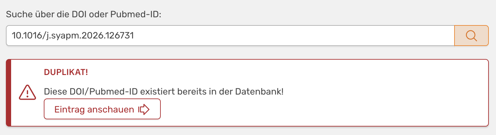
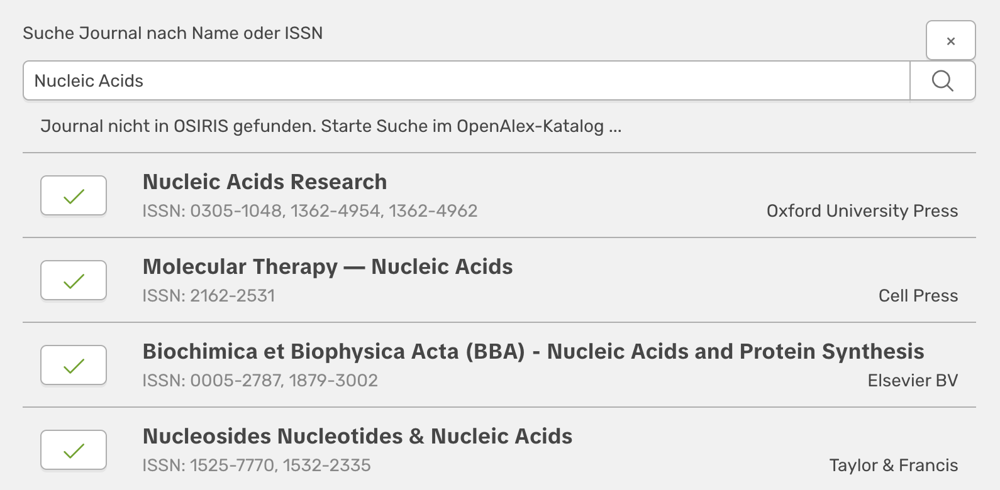

A publication has a title. A person has a name. A university has an address. So why do we also need cryptic strings such as `10.1000/xyz123`, `0000-0002-1825-0097` or `https://ror.org/03yrm5c26`?

The short answer: **because names and titles are not unique.**

Several people can share the same name. A person may change their name, publish using initials or have their name spelled differently across databases. Umlauts and other special characters are particularly prone to causing problems. Institutions change their names, merge or use names in several languages. Even publication titles are less reliable than they might seem: they can contain typos, appear in translation or be almost identical to other titles.

Identifiers solve this problem. They give people, publications, organisations and other objects a unique reference. In a research information system such as OSIRIS, they are therefore much more than a technical detail: they help match data correctly, prevent duplicates, bring information together from different sources and enrich records automatically.

## What is a persistent identifier?

An **identifier** is simply a unique reference to a particular object. A **persistent identifier**, or PID, goes a step further: it is intended to remain stable over time and keep the object findable even when, for example, its web address changes.

A conventional URL describes **where** something can currently be found. A persistent identifier describes **what** it is.

Think of it as moving house. When a journal reorganises its website or a repository moves to another server, an old URL may stop working. A DOI, however, stays the same. Behind the scenes, only the current address to which it points needs updating.

Not every identifier used in research is a persistent identifier in the strict technical sense. ISBNs, PMIDs and arXiv IDs each have their own rules and infrastructures. In the everyday work of a research information system, the key question is whether an identifier reliably identifies an object and enables links to other data sources.

## Why research information systems need identifiers

A research information system brings together information from many sources: researchers enter activities themselves, publications are imported, projects come from administrative processes, and organisations are linked to external partners. Without unique identifiers, the system would repeatedly have to guess from names, titles and other text fields whether two records refer to the same thing.

Identifiers provide reliable points of reference. Among other things, they enable:

- **Deduplication:** Two records with the same DOI refer to the same publication and should not be created twice.
- **Automated imports:** A DOI, ORCID iD or ROR ID can be used to retrieve structured metadata from public services.
- **Reliable links:** People, publications and organisations can be linked unambiguously across system boundaries.
- **Better data quality:** Standardised metadata reduces typos, inconsistent spelling and incomplete information.
- **Long-term findability:** References remain more stable even when websites or technical systems change.
- **Interoperability:** OSIRIS data can be exchanged more easily with repositories, library catalogues, research portals and other information systems.

As a general rule, the more **appropriate and verified** identifiers a record has, the better. A large number of unchecked identifiers does not help. What matters is that each ID is assigned to the correct object.

## The main identifiers at a glance

| Identifier | Identifies | Particularly relevant to | Typical example |
| --- | --- | --- | --- |
| DOI | Publications, datasets, software and other research objects | Almost all disciplines | Journal article or research dataset |
| ORCID iD | Researchers and other contributors | All disciplines | Unambiguous identification of a person |
| ROR ID | Research organisations | All disciplines | University, institute or funding organisation |
| ISBN | Individual editions of books | Especially the humanities and social sciences | Monograph or edited volume |
| ISSN | Continuing publications | Journals and series | Scholarly journal |
| PMID | Records in PubMed | Medicine and the life sciences | Biomedical journal article |
| PMCID | Freely accessible full texts in PubMed Central | Medicine and the life sciences | Archived full text of an article |
| arXiv ID | Preprints in arXiv | Physics, mathematics, computer science and related fields | Preprint |
| Handle or URN | Digital objects in repositories | Institutional publications and digital collections | Thesis or repository record |
| Accession number | Records in specialist databases | Fields including the life sciences and geosciences | Sequence, structure or sample record |
| OpenAlex ID | Research entities in the OpenAlex knowledge graph | Analysis and data linking | Work, person, institution or topic |

This list is not exhaustive. Depending on the discipline, other identifiers may be important, including patent numbers, clinical trial IDs, grant identifiers or IDs from specialist databases. The underlying principle remains the same: **different identifiers identify different kinds of things.**

## DOI: the key identifier for publications in OSIRIS

The **Digital Object Identifier**, or DOI, is one of the most important identifiers for scholarly publications today. DOIs are assigned to journal articles, book chapters, books, conference contributions, research data, reports and software, among other outputs. They are registered through official registration agencies such as [Crossref][1] or [DataCite][2].

DOIs are particularly valuable for OSIRIS because they serve several purposes at once.

### Preventing duplicates

Before creating a publication record, OSIRIS can check whether its DOI already exists in the system. This is much more reliable than comparing titles or author lists. Even small differences, such as a missing subtitle, different capitalisation or an extra hyphen, can make text comparisons difficult. The DOI remains unambiguous. For this process, OSIRIS normalises the DOI by converting it to lower case and removing the URL prefix where necessary.

### Importing metadata automatically

In many cases, a DOI is all you need instead of manually entering the title, authors, journal, publication year and other details. OSIRIS automatically retrieves the associated metadata from public services.

The import follows a series of steps:

1. OSIRIS first looks up the DOI in **Crossref**, one of the main registration agencies for DOIs of scholarly publications.
2. If no record is available there, OSIRIS looks for the DOI in **DataCite**. DataCite plays a particularly important role for research data, software and other research objects.
3. OSIRIS then enriches the record with information from **OpenAlex**. This may include open access information missing from the previous sources. OpenAlex also supplies citation counts and topic assignments, which OSIRIS uses for the Research Spectrum.

A single identifier can therefore produce a largely complete record enriched with additional information. This saves time while making metadata more consistent.

> In OSIRIS, a DOI is more than a link to a publication. It is the key to importing, enriching and deduplicating records.

A DOI alone does not guarantee perfect metadata, however. Registration metadata can also be incomplete or incorrect. Imported details should therefore still be reviewed, particularly names, publication types and institutional affiliations.

## ORCID iD: a unique identifier for people

Identifying people unambiguously is particularly difficult. Names can be shared, change over time or appear in different abbreviated forms in publications. Systems do not always handle special characters consistently. Moving to another institution should not fragment a person’s research profile either.

The **ORCID iD** provides a persistent, internationally established identifier. It belongs to the individual and can accompany them across institutions, publishers and research projects. Researchers can record publications, employment, education and other research activities in their ORCID records.

The ORCID integration was significantly expanded in **OSIRIS 2.1**. Once an institution has configured the integration and supplied the required API credentials, users can connect and authenticate their ORCID iDs directly in OSIRIS. This goes beyond entering a number in a profile: through ORCID, the person confirms that they have access to the associated account. This opens up further possibilities.

Data can then be imported from ORCID into OSIRIS. This makes it easier to maintain a profile and provides another bridge between the institutional research information system and international research infrastructure.

The distinction matters: an authenticated ORCID iD confirms the connection between the OSIRIS account and the ORCID account. It is not a general proof of identity and does not, on its own, establish the quality of every entry in the ORCID record.

## ROR: identifying organisations across different names

Organisations can also be surprisingly difficult to manage without identifiers. A university may appear under its German name, an English translation or an abbreviation. Institutes are renamed, spun off or merged. Different spellings and organisational levels add further complexity.

The **Research Organization Registry**, or ROR, provides open identifiers for research organisations. Alongside its preferred name, a ROR record includes information such as alternative names, location, website and relationships with other organisations.

OSIRIS uses ROR when creating organisation records centrally. Instead of entering all the details of an external institution manually, users can search ROR directly. The selected organisation is created using its unique ROR ID, and available metadata is imported. A particularly useful feature is that the organisation can immediately appear on the map when its coordinates are correctly assigned.

This helps prevent the same partner organisation from being entered several times under slightly different names. The ROR ID also improves subsequent analyses and data exchange with other systems. When publications, projects and collaborations use the same ROR ID, they can reliably be linked to the same organisation.

Not every organisation relevant to your research will be listed in ROR, however. Although ROR already contains more than 130,000 research organisations, some project partners or funders are still missing, and some may never be included. Your research might be funded by a local beekeeping association, for example, or a project partner might be a medium-sized company in the region. Authorised users create these organisations manually in OSIRIS, ideally adding alternative names and common abbreviations so that colleagues can find them too.

## ISBN: essential for books

Not all disciplines publish in the same way. In many natural and life sciences, journal articles with DOIs are central. In the social sciences and humanities, monographs, edited volumes and book chapters play a much larger role. Many still do not have a DOI.

This is where the **ISBN** is particularly important. It identifies a specific edition of a book. A hardback, paperback, e-book or new edition can therefore each have a different ISBN. This matters for deduplication: two different ISBNs do not necessarily represent two different works. They may identify different editions of the same title.

For book chapters, the ISBN generally belongs to the parent book or edited volume rather than the individual chapter. It helps identify the publication context but does not replace a chapter’s own DOI.

## ISSN for journals

The **ISSN** serves a different purpose. It identifies continuing publications such as journals or series, rather than individual articles. A journal’s print and online editions may have different ISSNs. Each ISSN is assigned only once, making it a unique identifier for the corresponding serial publication.

In OSIRIS, journals are stored centrally and can be linked to publications and other research activities, such as peer review and editorial work. This allows institutions to store further information alongside a journal’s name, including its publisher, categories and metrics by year.

Ideally, journals do not need to be created manually. They can be added through the relevant field when creating an activity. OSIRIS uses the open OpenAlex API to find journals, for example by name. Searching by ISSN is even better, as the unique identifier leads directly to the correct journal. Existing journals are linked, and missing journals are created. The required metadata on publishers, open access and other details also comes directly from OpenAlex.

## PMID and PMCID: key identifiers in medicine and the life sciences

The **PubMed ID**, or PMID, identifies a record in the PubMed literature database. It is widely used in medicine and the life sciences and is particularly useful for identifying publications unambiguously in these fields.

A PMID is not the same as a DOI. Many articles have both identifiers, but not every PubMed record has a DOI, and not every publication with a DOI is indexed in PubMed. Both IDs can therefore usefully be stored together.

OSIRIS can also search PubMed and import its metadata. Users simply enter the PubMed ID in the import field. The import works much like a DOI import, although the metadata quality may be lower for some fields.

The **PubMed Central ID**, or PMCID, is distinct from the PMID. It points to a freely accessible full text in the PubMed Central archive. A PMID and a PMCID can refer to the same article, but they identify records in different systems and serve different purposes.

At medical and life sciences institutions in particular, these subject-specific identifiers can significantly improve data quality and provide additional options for importing or matching records.

## Preprints, repositories and research data

Some disciplines and publication types have their own established identification systems:

- **arXiv IDs** are particularly common in physics, mathematics and computer science. They identify preprints and allow their different versions to be tracked.
- **Handles** and **URNs** are often used by institutional repositories, libraries and digital collections. They can, for example, provide persistent references to theses.
- **Accession numbers** identify records in specialist repositories, such as genome sequences, protein structures, biological samples or geoscientific data.
- **Clinical trial IDs** identify registered clinical trials and connect publications to the underlying studies.
- **OpenAlex IDs** identify entities in the OpenAlex knowledge graph. In OSIRIS, they are particularly useful for linking and enriching research information.

Research data and software increasingly receive DOIs too, often through DataCite. This demonstrates that DOIs have long extended beyond conventional articles.

## One object can have several identifiers

Several identifiers for the same object can be an advantage. A biomedical article may have a DOI, a PMID, a PMCID and an OpenAlex ID at the same time. Each connects it to a different infrastructure and enables different uses.

What matters is modelling the identifiers correctly:

- The DOI identifies the published article.
- The PMID identifies the PubMed record.
- The PMCID identifies the full text in PubMed Central.
- The OpenAlex ID identifies the work in the OpenAlex knowledge graph.

Together, these IDs create a denser network of connections. If one data source becomes unavailable or contains little metadata, another may provide additional information. They also increase the chances of reliably matching records across systems.

## Good identifiers, better research information

Identifiers may seem unremarkable at first glance. In research information management, however, they are an essential part of the data infrastructure. They turn isolated records into a connected information network.

A few simple principles help in practice:

1. **Capture identifiers as early as possible.** Including a DOI during import is more useful than adding it manually later.
2. **Use IDs appropriate to the entity.** An ISSN identifies a journal rather than an article within it. An ISBN identifies a book edition, rather than automatically identifying every chapter.
3. **Allow several relevant IDs.** DOIs and PMIDs complement each other.
4. **Check identifiers and obtain them from trusted sources where possible.** An incorrect ID can link records just as reliably to the wrong object as a correct ID can link them to the right one.
5. **Treat identifiers as more than links.** Their greatest value lies in machine-readable connections and automated data exchange.

This is why identifiers play such a central role in OSIRIS. DOIs simplify publication imports and prevent duplicates. ORCID connects people unambiguously to their international research profiles. ROR enables organisations to be created centrally using standardised records and high-quality metadata. ISSNs provide unique identifiers for journals, supporting deduplication and straightforward imports. Subject-specific identifiers extend this network wherever DOIs, ORCID iDs and ROR IDs alone are not enough.

The more research objects have appropriate, verified identifiers, the less people and systems have to guess. This improves individual records and the quality of the research information system as a whole.

> Good research information begins with a simple question: do we know exactly what, or whom, we are talking about?

[1]: https://crossref.org/
[2]: https://datacite.org/
